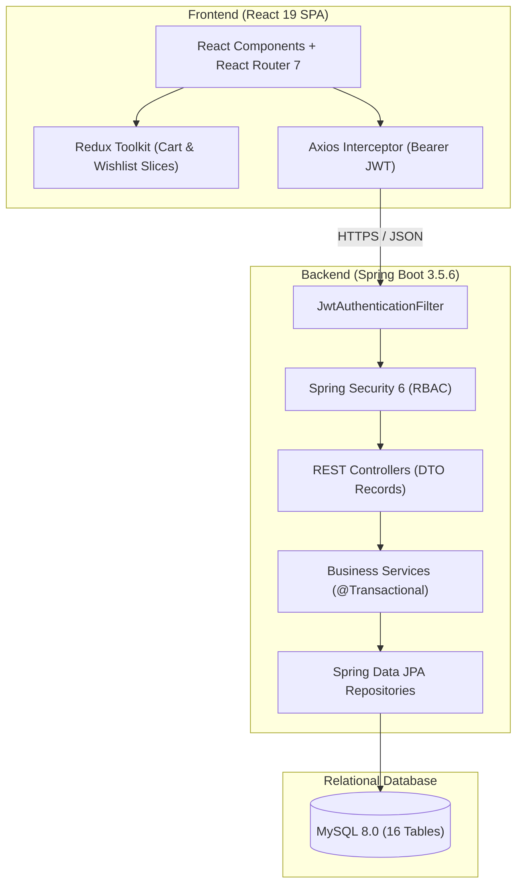
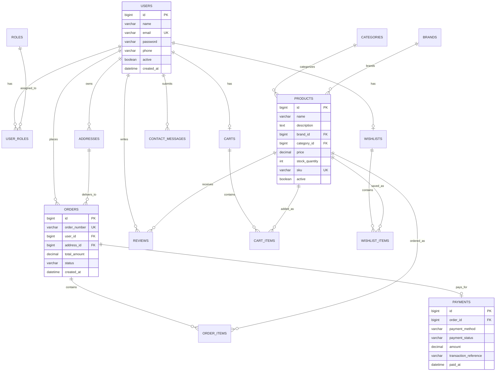
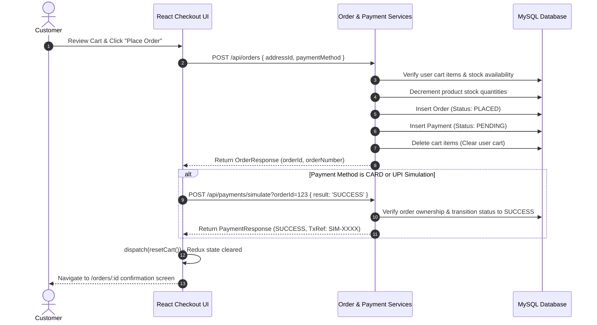

# ShopSphere — Online Store

> Full-stack e-commerce application built with Java, Spring Boot, React, and MySQL.

[](https://openjdk.org/projects/jdk/17/)
[](https://spring.io/projects/spring-boot)
[](https://spring.io/projects/spring-security)
[](https://react.dev/)
[](https://vitejs.dev/)
[](https://www.mysql.com/)
[](LICENSE)

---

## 1. Product Catalog Overview


*Figure 1: ShopSphere Product Catalog interface displaying multi-faceted filtering (category, brand, price range, rating), responsive product cards with localized INR pricing, real-time search, and interactive wishlist triggers.*

> **Note on Screenshot**: If you are exploring this repository freshly cloned from GitHub, follow the instructions in [`docs/screenshots/README.md`](docs/screenshots/README.md) to generate fresh 1080p UI captures from your local running instance.

---

## 2. Project Status & Limitations

- **Personal Contribution**: Solo developer (designed, implemented, and tested full-stack architecture).
- **Target Role**: Java Full Stack Developer (Hyderabad / Pan-India entry-level to junior engineering positions).
- **Deployment Status**: Configured for containerized or free-tier deployment (Render / Railway / TiDB Cloud); currently configured for local workstation development.
- **Payment Processing**: Simulation only. Payment transactions for Card and UPI are simulated through backend state machines; no real monetary gateway is claimed.
- **Automated Test Coverage**: 19 automated unit and service tests implemented with JUnit 5 and Mockito covering cart calculations, inventory validation, order workflows, and payment simulations.

---

## 3. Features & Verification Matrix

Features categorized by source verification and automated testing evidence:

| Feature Category | Description | Status |
| :--- | :--- | :---: |
| **Authentication & RBAC** | User registration with BCrypt hashing (cost 10), stateless JWT token issuance (`JJWT 0.12.6`), and role partitioning (`ROLE_CUSTOMER`, `ROLE_ADMIN`). | **Tested & Verified** |
| **Product Catalog** | Specification-driven search, category/brand filtering, price-range bounding, multi-mode sorting, and pagination. | **Tested & Verified** |
| **Cart Operations** | Cart item addition, quantity increments with stock validation, subtotal calculation, and item removal. Full table scans optimized with indexed DAO queries. | **Tested & Verified** |
| **Wishlist Management** | Saved-for-later items toggled directly from product cards or product details; per-user wishlist isolation. | **Source Verified** |
| **Checkout Workflow** | Saved delivery address selection, dynamic address creation, cart inventory availability validation, and atomic order placement. | **Tested & Verified** |
| **Payment Simulation** | Safe simulated payment lifecycle supporting Cash on Delivery, Simulated Card, and Simulated UPI with status tracking (`PENDING`, `SUCCESS`, `FAILED`). | **Tested & Verified** |
| **Order Management** | Customer order history, itemized breakdowns, status tracking (`PLACED`, `CONFIRMED`, `PACKED`, `OUT_FOR_DELIVERY`, `DELIVERED`, `CANCELLED`), and stock-restoring cancellation. | **Tested & Verified** |
| **Customer Profile** | Personal details update, BCrypt password change, and multi-address management with IDOR protection. | **Source Verified** |
| **Product Reviews** | Verified-purchaser review posting (guarded by order delivery verification), review ratings, and review moderation. | **Source Verified** |
| **Contact Form** | Inquiry submission form with support for both guest visitors and authenticated users. | **Source Verified** |
| **Admin Portal** | Summary dashboard metrics, product CRUD, category/brand CRUD, order status transitions, and real-time inventory stock management. | **Source Verified** |

---

## 4. Technology Stack

| Layer | Technologies & Libraries | Verified Version |
| :--- | :--- | :---: |
| **Backend Framework** | Spring Boot, Spring Web, Spring Validation | `3.5.6` |
| **Backend Runtime** | Java OpenJDK (Release Target 17) | `Java 17 / 21` |
| **Security & Auth** | Spring Security 6, JJWT (`jjwt-api`, `jjwt-impl`, `jjwt-jackson`), BCrypt | `0.12.6` |
| **Persistence & ORM** | Spring Data JPA, Hibernate 6.x | Managed by Spring Boot |
| **Database** | MySQL Server (`mysql-connector-j`) | `8.0+` |
| **Testing** | JUnit Jupiter 5, Mockito, AssertJ, Spring Test | `5.12.1` |
| **Frontend Framework** | React (JSX), React DOM | `19.2.8` |
| **Build Tool & Bundler**| Vite | `8.3.2` |
| **Client Routing** | React Router DOM | `7.18.4` |
| **State Management** | Redux Toolkit (`@reduxjs/toolkit`), React Redux | `2.13.0` / `9.3.0` |
| **HTTP Client** | Axios (with token interceptor) | `1.20.0` |
| **Code Quality** | ESLint with React Hooks & React Refresh rules | `10.10.0` |

---

## 5. Architecture Overview

ShopSphere uses a 3-tier decoupled architecture separating presentation, business logic, and relational storage.



---

## 6. Entity Relationship Diagram (ERD)

The database schema is fully normalized across 16 relational entities:



---

## 7. Core Workflow: Checkout & Payment Simulation



---

## 8. Prerequisites

Ensure the following tools are installed on your workstation:

- **Java Development Kit (JDK)**: Version 17 or higher (`java -version`)
- **Apache Maven**: Version 3.8+ (`mvn -version`)
- **Node.js**: Version 18+ (`node -v`)
- **npm**: Version 9+ (`npm -v`)
- **MySQL Server**: Version 8.0+ running on port 3306

---

## 9. Environment Configuration

Copy the template environment configuration file:

```bash
cp .env.example .env
```

### Configurable Environment Variables

| Variable Name | Default Value | Description |
| :--- | :--- | :--- |
| `PORT` | `8080` | Port on which Spring Boot backend listens |
| `SPRING_DATASOURCE_URL` | `jdbc:mysql://localhost:3306/online_store?useSSL=false&allowPublicKeyRetrieval=true&serverTimezone=UTC` | MySQL connection string |
| `SPRING_DATASOURCE_USERNAME` | `root` | Database username |
| `SPRING_DATASOURCE_PASSWORD` | `root` | Database password |
| `APP_JWT_SECRET` | *(Externalized HMAC Key)* | Base64-encoded secret for JWT signature verification (min. 256 bits) |
| `APP_JWT_EXPIRATION` | `86400000` | JWT token validity in milliseconds (24 hours) |
| `CORS_ALLOWED_ORIGINS` | `http://localhost:5173` | Comma-separated list of allowed frontend origins |
| `VITE_API_BASE_URL` | `http://localhost:8080/api` | REST API base URL consumed by React Axios client |

---

## 10. Database Setup & Initialization

1. Start your local MySQL server instance.
2. Create the database schema:
   ```sql
   CREATE DATABASE online_store CHARACTER SET utf8mb4 COLLATE utf8mb4_unicode_ci;
   ```
3. **Automatic Seeding**:  
   The application includes an automated `DataSeeder` (`CommandLineRunner`). On initial launch against an empty schema, it automatically seeds:
   - Security Roles (`ROLE_CUSTOMER`, `ROLE_ADMIN`)
   - Default Administrator account:
     - **Email**: `admin@store.com`
     - **Password**: `Admin@123`
   - Initial shoe categories (Running, Casual, Basketball)
   - Initial footwear brands (Nike, Adidas, Puma)
   - Initial shoe products with realistic images, pricing, and stock

---

## 11. Backend Setup & Run Commands

From the project root:

```bash
# Navigate to backend directory
cd backend

# Compile and run automated test suite
mvn test

# Package production executable JAR
mvn clean package

# Start the Spring Boot backend server
mvn spring-boot:run
```

The backend server starts listening on `http://localhost:8080`.

---

## 12. Frontend Setup & Run Commands

Open a second terminal:

```bash
# Navigate to frontend directory
cd frontend

# Install dependencies (respecting package-lock.json)
npm install

# Run ESLint check
npm run lint

# Build production assets
npm run build

# Start local development server
npm run dev
```

The React Single Page Application is available at `http://localhost:5173`.

---

## 13. REST API Specification

### Authentication (`/api/auth`)
| Method | Endpoint | Access | Description |
| :--- | :--- | :--- | :--- |
| `POST` | `/api/auth/register` | Public | Register new customer account and return JWT |
| `POST` | `/api/auth/login` | Public | Authenticate user credentials and return JWT |

### Catalog (`/api/products`, `/api/categories`, `/api/brands`)
| Method | Endpoint | Access | Description |
| :--- | :--- | :--- | :--- |
| `GET` | `/api/products` | Public | Search products with pagination, filters, and sorting |
| `GET` | `/api/products/{id}` | Public | Retrieve product details by ID |
| `GET` | `/api/categories` | Public | List all active product categories |
| `GET` | `/api/categories/{id}` | Public | Retrieve category details by ID |
| `GET` | `/api/brands` | Public | List all active product brands |
| `GET` | `/api/brands/{id}` | Public | Retrieve brand details by ID |

### Cart (`/api/cart`)
| Method | Endpoint | Access | Description |
| :--- | :--- | :--- | :--- |
| `GET` | `/api/cart` | Authenticated | Retrieve customer's active shopping cart |
| `POST` | `/api/cart/items` | Authenticated | Add product item to cart with stock validation |
| `PUT` | `/api/cart/items/{id}`| Authenticated | Update quantity of a cart item |
| `DELETE`| `/api/cart/items/{id}`| Authenticated | Remove specific item from cart |
| `DELETE`| `/api/cart` | Authenticated | Clear all items from customer cart |

### Wishlist (`/api/wishlist`)
| Method | Endpoint | Access | Description |
| :--- | :--- | :--- | :--- |
| `GET` | `/api/wishlist` | Authenticated | Retrieve customer's saved items |
| `POST` | `/api/wishlist/items/{productId}` | Authenticated | Save product to wishlist |
| `DELETE`| `/api/wishlist/items/{productId}` | Authenticated | Remove product from wishlist |

### Orders & Payments (`/api/orders`, `/api/payments`)
| Method | Endpoint | Access | Description |
| :--- | :--- | :--- | :--- |
| `POST` | `/api/orders` | Authenticated | Create order from cart items with address validation |
| `GET` | `/api/orders` | Authenticated | Retrieve logged-in customer's order history |
| `GET` | `/api/orders/{id}` | Authenticated | Retrieve itemized order details (ownership verified) |
| `POST` | `/api/orders/{id}/cancel` | Authenticated | Cancel placed order and restore product stock |
| `POST` | `/api/payments/simulate` | Authenticated | Execute safe payment simulation (`SUCCESS` / `FAILED`) |

### Customer Profile & Addresses (`/api/users/me`)
| Method | Endpoint | Access | Description |
| :--- | :--- | :--- | :--- |
| `GET` | `/api/users/me` | Authenticated | Get current authenticated user details |
| `PUT` | `/api/users/me` | Authenticated | Update personal profile name and phone |
| `PUT` | `/api/users/me/password` | Authenticated | Change account password (validates current password) |
| `GET` | `/api/users/me/addresses` | Authenticated | List customer saved delivery addresses |
| `POST` | `/api/users/me/addresses` | Authenticated | Save new delivery address |
| `PUT` | `/api/users/me/addresses/{id}` | Authenticated | Update existing address (IDOR protected) |
| `DELETE`| `/api/users/me/addresses/{id}` | Authenticated | Delete saved address |

### Reviews & Contact (`/api/reviews`, `/api/contact`)
| Method | Endpoint | Access | Description |
| :--- | :--- | :--- | :--- |
| `GET` | `/api/products/{id}/reviews` | Public | List reviews for a specific product |
| `POST` | `/api/products/{id}/reviews` | Authenticated | Submit review (requires verified delivered order) |
| `PUT` | `/api/reviews/{id}` | Authenticated | Update personal review rating/comment |
| `DELETE`| `/api/reviews/{id}` | Authenticated | Delete personal review |
| `POST` | `/api/contact` | Public / Auth | Submit customer contact inquiry message |

### Administration (`/api/admin/**`)
| Method | Endpoint | Access | Description |
| :--- | :--- | :--- | :--- |
| `GET` | `/api/admin/dashboard` | Role `ADMIN` | Metric summaries (Revenue, Orders, Products, Users) |
| `GET, POST` | `/api/admin/products` | Role `ADMIN` | List all products or create new catalog product |
| `PUT, DELETE`| `/api/admin/products/{id}`| Role `ADMIN` | Update product details or deactivate product |
| `GET, POST` | `/api/admin/categories` | Role `ADMIN` | List all categories or create new category |
| `PUT, DELETE`| `/api/admin/categories/{id}`| Role `ADMIN`| Update category details or deactivate category |
| `GET, POST` | `/api/admin/brands` | Role `ADMIN` | List all brands or create new brand |
| `PUT, DELETE`| `/api/admin/brands/{id}` | Role `ADMIN` | Update brand details or deactivate brand |
| `GET` | `/api/admin/orders` | Role `ADMIN` | View full order log across all customers |
| `PATCH` | `/api/admin/orders/{id}/status` | Role `ADMIN` | Advance order status (`CONFIRMED`, `DELIVERED`, etc.) |
| `GET` | `/api/admin/inventory` | Role `ADMIN` | Inspect inventory stock levels across all products |
| `PATCH` | `/api/admin/inventory/products/{id}` | Role `ADMIN` | Update product stock count directly |

---

## 14. Testing Results

### Automated Backend Tests
- **Test Command**: `mvn test`
- **Result**: `Tests run: 19, Failures: 0, Errors: 0, Skipped: 0`
- **Coverage**: Core business services (`CartService`, `OrderService`, `PaymentService`, `AuthService`, `ProductService`).
- **Regression Protection**: Verified zero regressions on cart boundary conditions, order empty-cart guards, IDOR protections, and stock restoration on cancellation.

### Frontend Quality & Build Verification
- **Lint Command**: `npm run lint` — **PASS** (0 errors, 0 warnings across all components and pages).
- **Build Command**: `npm run build` — **PASS** (Optimized Vite bundle generated in < 1 second).

---

## 15. Troubleshooting

1. **MySQL Access Denied (`CommunicationsException` or `Access denied for user`)**:
   - Check that MySQL is running on port 3306 (`Get-Service MySQL*` on Windows or `systemctl status mysql` on Linux).
   - Ensure the database `online_store` exists.
   - Verify `SPRING_DATASOURCE_USERNAME` and `SPRING_DATASOURCE_PASSWORD` match your local MySQL credentials.
2. **CORS Error in Browser Console (`No 'Access-Control-Allow-Origin' header`)**:
   - Verify that your frontend is running on `http://localhost:5173`.
   - If using a custom Vite port, update `app.cors.allowed-origins` in `backend/src/main/resources/application.properties` or pass `-DCORS_ALLOWED_ORIGINS=http://localhost:your_port`.
3. **Cart Quantity Update returns HTTP 400**:
   - The backend strictly enforces inventory limits. If you request a quantity greater than `product.stockQuantity`, the backend returns `Requested quantity exceeds available stock`. Check the inventory count in the admin dashboard.
4. **Checkout returns HTTP 400**:
   - Ensure you have at least one delivery address saved and selected.
   - Ensure your shopping cart contains at least one active product.

---

## 16. Future Roadmap

- [ ] **Real Payment Gateway Integration**: Integrate Razorpay or Stripe webhook-driven payment processing.
- [ ] **Image Upload Service**: Integrate AWS S3 or Cloudinary for direct product image uploads from the Admin panel.
- [ ] **OAuth2 Social Sign-In**: Add Google and GitHub one-click authentication.
- [ ] **Email Notifications**: Dispatch order confirmation and dispatch emails using Spring Boot Starter Mail.
- [ ] **Redis Caching**: Cache product catalog pages and category trees in Redis for sub-millisecond response times.

---

## 17. Author & Contact

- **Developer**: Prashanth Maturi
- **Role**: Java Full Stack Developer
- **Location**: Hyderabad, Telangana, India
- **Repository**: [https://github.com/prashanthmaturi/online-store-fullstack](https://github.com/prashanthmaturi/online-store-fullstack) *(Configure your repository remote)*
- **LinkedIn**: *(Add your LinkedIn profile link)*
- **Email**: *(Add your contact email)*
