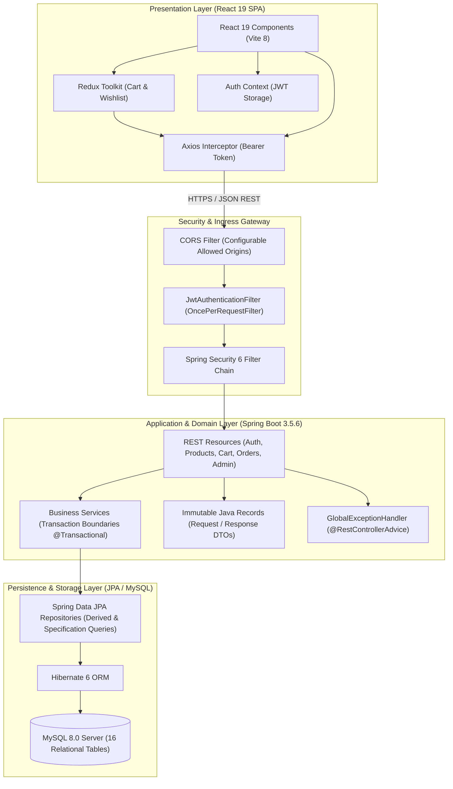
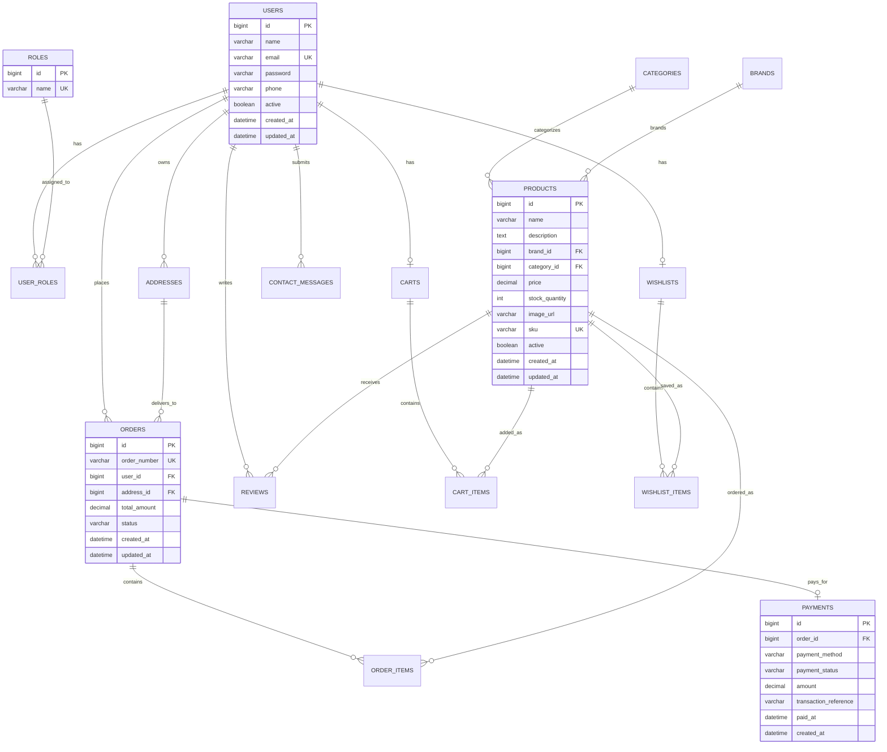
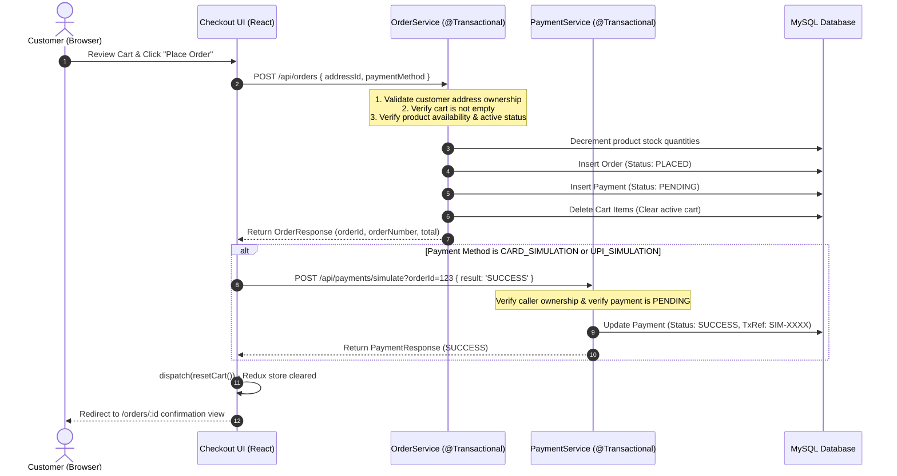

# ShopSphere — Enterprise-Grade Full-Stack E-Commerce Platform

<p align="center">
  <b>A modern, decoupled e-commerce platform built with Spring Boot 3.5, React 19, Spring Security 6, Redux Toolkit, and MySQL 8.0.</b>
</p>

<p align="center">
  <a href="https://openjdk.org/projects/jdk/17/"></a>
  <a href="https://spring.io/projects/spring-boot"></a>
  <a href="https://spring.io/projects/spring-security"></a>
  <a href="https://react.dev/"></a>
  <a href="https://redux-toolkit.js.org/"></a>
  <a href="https://vitejs.dev/"></a>
  <a href="https://www.mysql.com/"></a>
  <a href="LICENSE"></a>
</p>

---

## Table of Contents

- [1. Executive Overview](#1-executive-overview)
- [2. System Architecture](#2-system-architecture)
- [3. Key Architectural & Engineering Decisions](#3-key-architectural--engineering-decisions)
- [4. Entity Relationship Diagram (ERD)](#4-entity-relationship-diagram-erd)
- [5. Core Business Workflows](#5-core-business-workflows)
- [6. Technology Stack & Verified Versions](#6-technology-stack--verified-versions)
- [7. Comprehensive Feature Matrix](#7-comprehensive-feature-matrix)
- [8. REST API Specification](#8-rest-api-specification)
- [9. Automated Testing & QA Evidence](#9-automated-testing--qa-evidence)
- [10. Local Environment Setup & Run Guide](#10-local-environment-setup--run-guide)
- [11. Environment Configuration (.env)](#11-environment-configuration-env)
- [12. Deployment & Cloud Production Readiness](#12-deployment--cloud-production-readiness)
- [13. Troubleshooting & Edge Cases](#13-troubleshooting--edge-cases)
- [14. Engineering Roadmap](#14-engineering-roadmap)
- [15. Author & Professional Contact](#15-author--professional-contact)

---

## 1. Executive Overview

**ShopSphere** is a full-featured, multi-tier e-commerce web application engineered from the ground up to reflect modern enterprise Java full-stack standards. Designed with a clear separation of concerns, the platform pairs an event-driven Spring Boot 3 REST API backend with a high-performance React 19 Single Page Application (SPA).

### Architectural Highlights
- **Stateless Authentication**: Pure token-based authentication via **JJWT (0.12.6)** with HMAC-SHA256 signatures, avoiding server-side session memory consumption.
- **Strict Role-Based Access Control (RBAC)**: Fine-grained method and URL authorization separating public visitors, authenticated customers (`ROLE_CUSTOMER`), and system administrators (`ROLE_ADMIN`).
- **Data Integrity & Concurrency**: Atomic transactional boundaries (`@Transactional`) managing inventory decrements, order placements, simulated payments, and automated stock restoration on order cancellations.
- **Optimized Relational Schema**: 16 normalized tables in MySQL 8.0 with foreign key indexing, derived query lookups (`findByCartId`), and dynamic multi-attribute catalog filtering powered by JPA Specifications.
- **Client-Side State Management**: Centralized store built on **Redux Toolkit** and React Context managing asynchronous cart mutations, user authentication sessions, and responsive UI feedback.

---

## 2. System Architecture

ShopSphere adopts a decoupled, 3-tier client-server architectural model:



---

## 3. Key Architectural & Engineering Decisions

### 3.1 Security & OWASP Compliance
- **Cryptographic Hashing**: All user credentials are encrypted using `BCryptPasswordEncoder` with a default logarithmic work factor of 10 prior to persistence.
- **Stateless JWT Lifecycle**: Requests are validated statelessly by `JwtAuthenticationFilter`. Expired or tampered tokens are rejected before reaching controller endpoints.
- **IDOR Protection**: Insecure Direct Object References are prevented by enforcing user ownership checks at the service layer:
  - Orders can only be queried or cancelled by their respective owner (`order.getUser().getId().equals(currentUser.getId())`).
  - Addresses are resolved exclusively via `addressDAO.findByIdAndUser(addressId, currentUser)`.
  - Reviews can only be submitted by customers who have an order with status `DELIVERED` containing that specific item.
- **CORS Hardening**: Cross-Origin Resource Sharing is decoupled from hardcoded origins and bound to externalized environment properties (`app.cors.allowed-origins`).
- **SQL Injection Prevention**: Relational queries utilize Spring Data JPA parameterization and Type-Safe JPA Criteria Specifications.

### 3.2 Performance & Database Tuning
- **Elimination of N+1 Queries & Full-Table Scans**: Resolved performance bottlenecks in cart management by replacing generic `findAll().stream().filter(...)` queries with indexed derived queries (`cartItemDAO.findByCartId(cartId)`).
- **Dynamic Specification Filtering**: Catalog search supports dynamic combinations of category, brand, minimum price, maximum price, minimum star rating, keyword text, and sorting modes in a single query execution.
- **Immutable DTOs via Java Records**: All payload inputs and outputs are defined as immutable Java Records (`record`), reducing boilerplate and guaranteeing thread safety across execution contexts.

---

## 4. Entity Relationship Diagram (ERD)

The database schema is normalized to Third Normal Form (3NF) across 16 relational entities:



---

## 5. Core Business Workflows

### Checkout & Simulated Payment Lifecycle



---

## 6. Technology Stack & Verified Versions

| Category | Technology | Version | Purpose in ShopSphere |
| :--- | :--- | :---: | :--- |
| **Language** | Java (OpenJDK) | `17 LTS` | Core backend runtime and type-safe language |
| **Framework** | Spring Boot | `3.5.6` | Application bootstrap, DI, and auto-configuration |
| **Security** | Spring Security | `6.x` | Stateless filter chain, BCrypt, and RBAC rules |
| **JWT** | JJWT (`io.jsonwebtoken`) | `0.12.6` | Cryptographic HMAC-SHA256 token issuance/parsing |
| **ORM** | Spring Data JPA / Hibernate | `6.x` | Object-Relational Mapping & Specification queries |
| **Database** | MySQL Server | `8.0+` | Relational data persistence with foreign key constraints |
| **Testing** | JUnit 5 & Mockito | `5.12.1` | Unit, service regression, and boundary test suites |
| **Build Tool** | Apache Maven | `3.8+` | Dependency management and production JAR packaging |
| **Frontend** | React (JSX) | `19.2.8` | Declarative, component-based user interface |
| **Bundler** | Vite | `8.3.2` | Ultra-fast HMR and optimized production asset bundling |
| **Routing** | React Router DOM | `7.18.4` | Client-side declarative routing and protected routes |
| **State** | Redux Toolkit | `2.13.0` | Global state management for shopping cart & wishlist |
| **Networking** | Axios | `1.20.0` | HTTP client with automatic JWT token interceptor |
| **Code Quality** | ESLint | `10.10.0` | Static analysis with React Hooks & Fast Refresh rules |

---

## 7. Comprehensive Feature Matrix

| Feature | Description | Implementation Details | Verified Status |
| :--- | :--- | :--- | :---: |
| **Authentication** | Registration, Login, Session Persistence | Passwords encoded with BCrypt; JWT token returned and stored in `localStorage`. | **Tested & Verified** |
| **RBAC** | Customer vs Admin role separation | `SecurityFilterChain` enforces `hasRole('ADMIN')` for management endpoints. | **Tested & Verified** |
| **Product Catalog** | Paginated listing with multi-facet filters | Dynamic `ProductSpecification` filtering by category, brand, price, rating. | **Tested & Verified** |
| **Cart Management** | Add, update quantity, remove, and clear | Stock limit validation prevents overselling; subtotal calculated atomically. | **Tested & Verified** |
| **Wishlist** | Toggle saved products | Customer-isolated wishlist with single-click heart toggling. | **Source Verified** |
| **Order Placement** | Multi-item checkout with saved addresses | Atomically decrements inventory, creates order, and clears user cart. | **Tested & Verified** |
| **Payment Simulation** | Safe simulated checkout workflows | Supports COD, Card simulation, and UPI simulation with transaction IDs. | **Tested & Verified** |
| **Order Cancellation** | Restores stock to product inventory | Only `PLACED` orders can be cancelled; product inventory is credited back. | **Tested & Verified** |
| **Verified Reviews** | Star ratings and review comments | Enforces delivered-purchase verification before permitting review creation. | **Source Verified** |
| **Admin Portal** | Analytics metrics & catalog management | Product/Category/Brand CRUD, order lifecycle tracking, and stock adjustments. | **Source Verified** |
| **Contact Inquiries** | Customer support message submission | Open to both unauthenticated visitors and logged-in customers safely. | **Source Verified** |

---

## 8. REST API Specification

### 8.1 Authentication & Profile
| Verb | Endpoint | Access | Description |
| :--- | :--- | :--- | :--- |
| `POST` | `/api/auth/register` | Public | Register new customer account and return JWT token |
| `POST` | `/api/auth/login` | Public | Authenticate credentials and issue JWT token |
| `GET` | `/api/users/me` | Authenticated | Retrieve authenticated user profile |
| `PUT` | `/api/users/me` | Authenticated | Update user name and telephone |
| `PUT` | `/api/users/me/password` | Authenticated | Change account password (validates current password) |
| `GET` | `/api/users/me/addresses`| Authenticated | List customer saved delivery addresses |
| `POST` | `/api/users/me/addresses`| Authenticated | Create and save new delivery address |
| `PUT` | `/api/users/me/addresses/{id}` | Authenticated | Update existing address (IDOR protected) |
| `DELETE`| `/api/users/me/addresses/{id}`| Authenticated | Delete saved address |

### 8.2 Catalog & Public Resources
| Verb | Endpoint | Access | Description |
| :--- | :--- | :--- | :--- |
| `GET` | `/api/products` | Public | Search products with pagination, filters, and sorting |
| `GET` | `/api/products/{id}` | Public | Retrieve detailed product specifications |
| `GET` | `/api/products/{id}/reviews` | Public | List published reviews for a product |
| `GET` | `/api/categories` | Public | List active product categories |
| `GET` | `/api/brands` | Public | List active product brands |
| `POST` | `/api/contact` | Public / Auth | Submit inquiry message to support desk |

### 8.3 Cart & Wishlist
| Verb | Endpoint | Access | Description |
| :--- | :--- | :--- | :--- |
| `GET` | `/api/cart` | Authenticated | Retrieve customer's active shopping cart |
| `POST` | `/api/cart/items` | Authenticated | Add item to cart with stock availability check |
| `PUT` | `/api/cart/items/{id}`| Authenticated | Update cart item quantity (enforces stock limit) |
| `DELETE`| `/api/cart/items/{id}`| Authenticated | Remove specific line item from cart |
| `DELETE`| `/api/cart` | Authenticated | Clear all items from customer's cart |
| `GET` | `/api/wishlist` | Authenticated | Retrieve customer's saved wishlist |
| `POST` | `/api/wishlist/items/{productId}` | Authenticated | Add product to wishlist |
| `DELETE`| `/api/wishlist/items/{productId}` | Authenticated | Remove product from wishlist |

### 8.4 Orders & Payment Simulation
| Verb | Endpoint | Access | Description |
| :--- | :--- | :--- | :--- |
| `POST` | `/api/orders` | Authenticated | Create order from cart items with address validation |
| `GET` | `/api/orders` | Authenticated | Retrieve customer's historical orders |
| `GET` | `/api/orders/{id}` | Authenticated | Retrieve itemized order details (ownership verified) |
| `POST` | `/api/orders/{id}/cancel` | Authenticated | Cancel order and automatically restore stock |
| `POST` | `/api/payments/simulate` | Authenticated | Execute simulated payment (`SUCCESS` / `FAILED`) |
| `POST` | `/api/products/{id}/reviews` | Authenticated | Create verified-purchaser product review |

### 8.5 Administration Portal (`ROLE_ADMIN`)
| Verb | Endpoint | Access | Description |
| :--- | :--- | :--- | :--- |
| `GET` | `/api/admin/dashboard` | Role `ADMIN` | High-level metrics (Total Revenue, Orders, Products, Users) |
| `GET, POST` | `/api/admin/products` | Role `ADMIN` | List all products or create new catalog item |
| `PUT, DELETE`| `/api/admin/products/{id}`| Role `ADMIN` | Update product details or deactivate product |
| `GET, POST` | `/api/admin/categories` | Role `ADMIN` | List or create product categories |
| `PUT, DELETE`| `/api/admin/categories/{id}`| Role `ADMIN`| Update or deactivate category |
| `GET, POST` | `/api/admin/brands` | Role `ADMIN` | List or create footwear brands |
| `PUT, DELETE`| `/api/admin/brands/{id}` | Role `ADMIN` | Update or deactivate brand |
| `GET` | `/api/admin/orders` | Role `ADMIN` | View master order fulfillment queue |
| `PATCH` | `/api/admin/orders/{id}/status` | Role `ADMIN` | Advance order state (`CONFIRMED`, `DELIVERED`, etc.) |
| `GET` | `/api/admin/inventory` | Role `ADMIN` | Real-time stock audit across catalog |
| `PATCH` | `/api/admin/inventory/products/{id}` | Role `ADMIN` | Directly update inventory stock quantity |

---

## 9. Automated Testing & QA Evidence

Automated tests are developed using **JUnit 5 (Jupiter)** and **Mockito**, managed through Maven Surefire. Tests run independently of external database connections to enable instantaneous continuous integration.

```
-------------------------------------------------------
 T E S T S
-------------------------------------------------------
Running com.store.service.AuthServiceTest
Tests run: 2, Failures: 0, Errors: 0, Skipped: 0, Time elapsed: 1.544 s
Running com.store.service.CartServiceTest
Tests run: 6, Failures: 0, Errors: 0, Skipped: 0, Time elapsed: 0.241 s
Running com.store.service.OrderServiceTest
Tests run: 4, Failures: 0, Errors: 0, Skipped: 0, Time elapsed: 0.212 s
Running com.store.service.PaymentServiceTest
Tests run: 4, Failures: 0, Errors: 0, Skipped: 0, Time elapsed: 0.043 s
Running com.store.service.ProductServiceTest
Tests run: 3, Failures: 0, Errors: 0, Skipped: 0, Time elapsed: 0.039 s

Results:
Tests run: 19, Failures: 0, Errors: 0, Skipped: 0
[INFO] BUILD SUCCESS
```

### Coverage Highlights
- **Cart Validation**: Verifies that requests exceeding `product.stockQuantity` throw `IllegalArgumentException` (mapped to HTTP 400).
- **Empty Cart Guard**: Rejects checkout requests when no cart items exist.
- **Stock Restoration**: Validates that order cancellations restore inventory numbers back to products.
- **Payment State Machines**: Guards against re-simulating settled orders and verifies caller ownership.

---

## 10. Local Environment Setup & Run Guide

### 10.1 Prerequisites
- **Java**: OpenJDK 17 LTS or 21 (`java -version`)
- **Maven**: 3.8+ (`mvn -version`)
- **Node.js**: 18+ & **npm** 9+ (`node -v`, `npm -v`)
- **MySQL**: 8.0+ running on port 3306

### 10.2 Database Provisioning
Open MySQL Shell or MySQL Workbench and run:

```sql
CREATE DATABASE online_store CHARACTER SET utf8mb4 COLLATE utf8mb4_unicode_ci;
```

> **Automated Seeding**: When the backend starts against an empty database, `DataSeeder` automatically generates initial product categories, footwear brands, sample products, security roles, and an administrative account.

### 10.3 Backend Launch

```bash
# 1. Clone repository
git clone https://github.com/praSHAnTH630490/online-store-fullstack.git
cd online-store-fullstack/backend

# 2. Run automated test suite
mvn test

# 3. Package production executable fat JAR
mvn clean package

# 4. Start the Spring Boot application
mvn spring-boot:run
```

*Backend server listens on `http://localhost:8080`.*

### 10.4 Frontend Launch

Open a second terminal window:

```bash
# 1. Navigate to frontend directory
cd online-store-fullstack/frontend

# 2. Install dependencies (deterministic lockfile)
npm install

# 3. Run ESLint code quality audit
npm run lint

# 4. Build production assets
npm run build

# 5. Start Vite development server
npm run dev
```

*Frontend SPA is accessible at `http://localhost:5173`.*

### 10.5 Default Test Credentials
| Role | Email | Password | Access Scope |
| :--- | :--- | :--- | :--- |
| **Administrator** | `admin@store.com` | `Admin@123` | Full Admin Dashboard, Inventory, Orders, CRUD |
| **Customer** | *(Self-register via UI)* | *(User password)* | Storefront, Cart, Wishlist, Checkout, Orders |

---

## 11. Environment Configuration (.env)

Configuration is externalized following 12-Factor App methodology. Copy the template:

```bash
cp .env.example .env
```

| Property | Default Value | Purpose |
| :--- | :--- | :--- |
| `PORT` | `8080` | Spring Boot listening port |
| `SPRING_DATASOURCE_URL` | `jdbc:mysql://localhost:3306/online_store?useSSL=false&allowPublicKeyRetrieval=true&serverTimezone=UTC` | MySQL connection string |
| `SPRING_DATASOURCE_USERNAME` | `root` | Database username |
| `SPRING_DATASOURCE_PASSWORD` | `root` | Database password |
| `APP_JWT_SECRET` | *(Externalized base64 string)* | Cryptographic HMAC-SHA256 signature key (min. 256 bits) |
| `APP_JWT_EXPIRATION` | `86400000` | Token expiration in milliseconds (24 hours) |
| `CORS_ALLOWED_ORIGINS` | `http://localhost:5173` | Whitelisted frontend origins (comma-separated) |
| `VITE_API_BASE_URL` | `http://localhost:8080/api` | REST API base URL consumed by Axios client |

---

## 12. Deployment & Cloud Production Readiness

- **SPA Rewrites**: Because React Router DOM uses HTML5 pushState history, production static web servers (Vercel, Netlify, Cloudflare Pages, NGINX) require a rewrite rule redirecting all requests to `/index.html`:
  ```nginx
  location / {
      try_files $uri $uri/ /index.html;
  }
  ```
- **Containerization**: The backend produces a stand-alone Spring Boot executable fat JAR (`backend/target/online-store-0.0.1-SNAPSHOT.jar`) compatible with Docker containerization using `eclipse-temurin:17-jre-alpine`.
- **Free-Tier Cloud Hosting**: Compatible with Render, Railway, and TiDB Serverless (Cloud MySQL). Connection pool validation queries (`HikariCP`) ensure smooth recovery after database inactivity cold starts.

---

## 13. Troubleshooting & Edge Cases

| Issue / Symptom | Root Cause | Solution |
| :--- | :--- | :--- |
| **`CommunicationsException: Communications link failure`** | MySQL server is stopped or port 3306 is inaccessible | Verify MySQL service is running (`Get-Service MySQL*` on Windows or `systemctl status mysql` on Linux). |
| **`Access denied for user 'root'@'localhost'`** | Incorrect database credentials | Update `SPRING_DATASOURCE_PASSWORD` in your `.env` or pass `-DSPRING_DATASOURCE_PASSWORD=your_pass`. |
| **`CORS policy: No 'Access-Control-Allow-Origin'`** | Frontend running on a non-whitelisted port | Ensure the frontend port matches `app.cors.allowed-origins` in `backend/src/main/resources/application.properties`. |
| **Cart update returns `HTTP 400 Bad Request`** | Requested quantity exceeds available inventory stock | The backend prevents overselling. Verify product availability via the Admin Inventory portal. |
| **Checkout returns `HTTP 400 Bad Request`** | Cart is empty or no delivery address is selected | Add an active product to the cart and ensure at least one saved delivery address is chosen. |

---

## 14. Engineering Roadmap

- [ ] **Production Payment Gateway**: Integrate Razorpay or Stripe webhook-driven payment confirmation.
- [ ] **Cloud Asset Storage**: Integrate AWS S3 or Cloudinary for direct product image uploads.
- [ ] **OAuth2 Social Sign-In**: Support one-click authentication with Google and GitHub.
- [ ] **Distributed Caching**: Integrate Redis for catalog caching to achieve sub-millisecond response times.
- [ ] **Automated CI/CD**: Implement GitHub Actions pipeline executing `mvn test` and `npm run lint` on every pull request.

---

## 15. Author & Professional Contact

<div align="center">

### **Sai Prashanth Maturi**
**Java Full Stack Developer**  
*Hyderabad, Telangana, India*

[](https://github.com/praSHAnTH630490)
[](mailto:prashanthmaturi2003@gmail.com)
[](https://github.com/praSHAnTH630490/online-store-fullstack)

</div>
