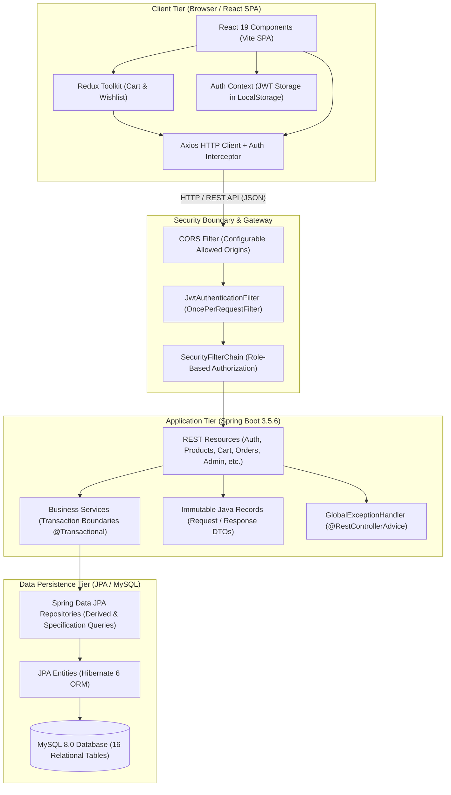
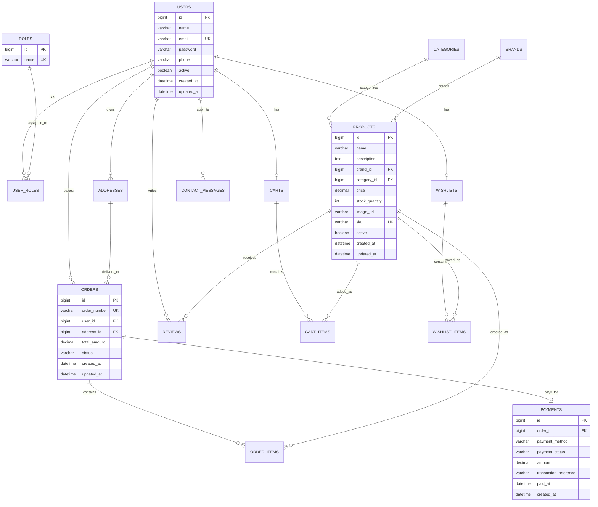
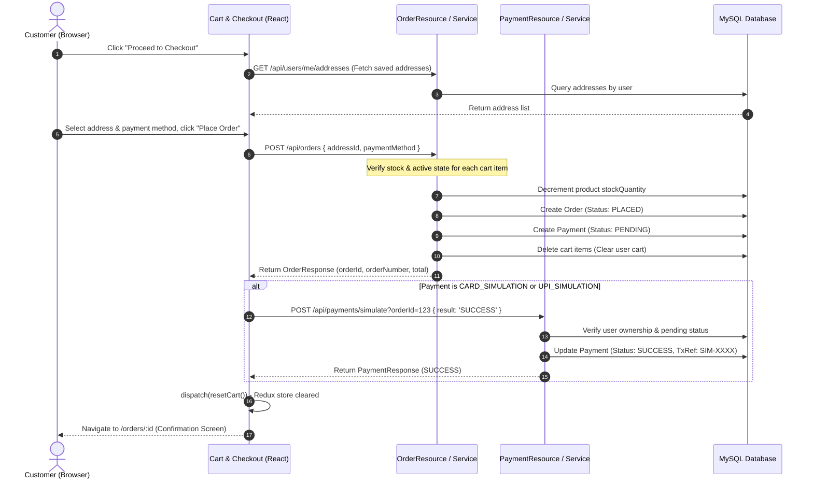

# ShopSphere — Architecture & System Design Documentation

## 1. Executive Summary

**ShopSphere** is a production-grade full-stack e-commerce web platform engineered with a decoupled client-server architecture. The backend is built with **Java 17**, **Spring Boot 3.5.6**, **Spring Security 6**, and **Spring Data JPA** connected to a **MySQL 8.0** relational database. The presentation layer is a responsive Single-Page Application (SPA) powered by **React 19**, **Vite 8**, **React Router 7**, and **Redux Toolkit**.

---

## 2. High-Level System Architecture

The application adopts a 3-tier decoupled architecture:

---

## 3. Security Architecture

### 3.1 Authentication & Token Lifecycle
1. **User Registration & Login**:
   - Passwords are encrypted before persistence using `BCryptPasswordEncoder` with a default cost factor of 10.
   - Authentication is performed statelessly via Spring Security's `AuthenticationManager` and `DaoAuthenticationProvider`.
   - On successful credentials validation, `JwtService` issues an HMAC-SHA256 signed JSON Web Token (JWT) encapsulating username, roles, issue timestamp, and expiration.
2. **Stateless Request Authentication**:
   - The React client passes the token on every authenticated request via the standard `Authorization: Bearer <token>` header, injected automatically through an Axios request interceptor.
   - The server's `JwtAuthenticationFilter` intercepts each request, parses and cryptographically validates the token against the externalized secret key, extracts the principal and user authorities (`ROLE_CUSTOMER`, `ROLE_ADMIN`), and populates Spring's `SecurityContextHolder`.

### 3.2 Role-Based Access Control (RBAC)
- **Public Endpoints (`permitAll`)**:
  - `POST /api/auth/**` (Registration, Login)
  - `GET /api/categories/**` (Public category catalog)
  - `GET /api/brands/**` (Public brand listing)
  - `GET /api/products/**` (Catalog search, details, and public reviews)
  - `POST /api/contact` (Contact messages submitted by visitors or members)
- **Customer Endpoints (`authenticated`)**:
  - `GET, POST, PUT, DELETE /api/cart/**` (Cart operations)
  - `GET, POST, DELETE /api/wishlist/**` (Wishlist management)
  - `GET, POST /api/orders/**` (Checkout, order history, order cancellation)
  - `POST /api/payments/simulate` (Safe simulated payment execution)
  - `GET, PUT /api/users/me/**` (Customer profile & address management)
  - `POST, PUT, DELETE /api/reviews/**` (Verified-purchaser review publishing)
- **Administrator Endpoints (`hasRole('ADMIN')`)**:
  - `/api/admin/**` (Product CRUD, Category CRUD, Brand CRUD, Order status lifecycle, and stock inventory management)

### 3.3 Resource Ownership Verification
The system enforces strict multi-tenant customer separation at the service layer:
- **Orders**: A user can only access or cancel orders where `order.getUser().getId().equals(currentUser.getId())`.
- **Addresses**: Address lookup, update, and deletion queries utilize `findByIdAndUser(addressId, currentUser)` to prevent Insecure Direct Object References (IDOR).
- **Cart & Wishlist**: Cart items and wishlist items are bounded to the logged-in customer's persistent user identity.
- **Reviews**: Only delivered orders containing the specific product allow a customer to write a review (`ReviewService.hasPurchasedProduct`).

---

## 4. Entity Relationship Diagram (ERD)

The MySQL database schema comprises 16 normalized relational tables:

---

## 5. Core End-to-End Workflow

### Checkout & Simulated Payment Flow

---

## 6. Deployment Readiness & Cloud Strategy

### 6.1 Frontend Single-Page Application (SPA)
- Build output consists of static HTML, CSS, and JS chunks (`dist/`).
- Hosting options: Vercel, Netlify, Cloudflare Pages, or GitHub Pages.
- **Routing Requirement**: A rewrite rule is mandatory so that deep routes (e.g. `/orders/12`, `/products/5`) redirect to `/index.html` (e.g. `_redirects` file with `/* /index.html 200`).

### 6.2 Backend Container & API Runtime
- Containerized using Docker with multi-stage build or run directly on Render, Railway, or AWS Elastic Beanstalk using OpenJDK 17/21.
- All sensitive properties (`SPRING_DATASOURCE_URL`, `SPRING_DATASOURCE_USERNAME`, `SPRING_DATASOURCE_PASSWORD`, `APP_JWT_SECRET`, `CORS_ALLOWED_ORIGINS`, `PORT`) are externalized via environment variables.

### 6.3 Database Free-Tier Considerations
- Cloud MySQL options: TiDB Serverless, Aiven MySQL Free, or Railway MySQL.
- Free-tier compute nodes sleep after inactivity (cold starts ~30-50s). Connection timeouts and connection pool health checks (`testOnBorrow` / HikariCP validation) are configured to recover automatically upon wakeup.
