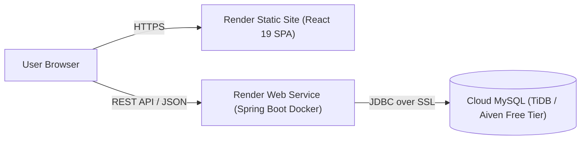

# Deploying ShopSphere on Render (Free-Tier Step-by-Step Guide)

This guide walks you through deploying **ShopSphere** (Spring Boot Backend + React Frontend + Cloud MySQL) on [Render](https://render.com).

---

## Architecture on Render



---

## Step 1: Provision a Free Cloud MySQL Database (2 Minutes)

Render does not offer a free native MySQL database (Render only offers PostgreSQL natively). To maintain 100% MySQL compatibility without code modifications, use a free cloud MySQL provider:

### Option A: TiDB Serverless (Recommended — 100% MySQL 8.0 Compatible, Free 5GB, No Credit Card)
1. Go to [https://tidbcloud.com](https://tidbcloud.com) and sign up with GitHub or Google.
2. Click **Create Cluster** $\rightarrow$ Select **Serverless** (Free Tier).
3. Choose your nearest region (e.g. `ap-southeast-1` Singapore or `us-east-1`).
4. Click **Connect** $\rightarrow$ Select **Java / Spring Boot** to view your connection details:
   - **Host & Port**: e.g., `gateway01.ap-southeast-1.prod.aws.tidbcloud.com:4000`
   - **Database**: `test` or create `online_store`
   - **User**: e.g., `xxxxxx.root`
   - **Password**: `your_generated_password`
   - **JDBC URL**:
     ```text
     jdbc:mysql://<host>:4000/online_store?useSSL=true&verifyServerCertificate=true&serverTimezone=UTC
     ```

### Option B: Aiven for MySQL (Free Tier)
1. Sign up at [https://aiven.io](https://aiven.io).
2. Create a free MySQL service and copy the Service URI / JDBC parameters.

---

## Step 2: Deploy Using Render Blueprint (`render.yaml`)

ShopSphere already includes an automated Infrastructure-as-Code blueprint file: [`render.yaml`](../render.yaml).

1. Log in to [Render Dashboard](https://dashboard.render.com).
2. Click the **New +** button in the top right $\rightarrow$ Select **Blueprint**.
3. Connect your GitHub account and select your repository:
   ```text
   praSHAnTH630490/shopsphere-fullstack-fp
   ```
4. Render will automatically detect `render.yaml` and discover two services:
   - **`shopsphere-backend`**: Docker Web Service (Spring Boot 3.5.6)
   - **`shopsphere-frontend`**: Static Site (React 19 + Vite 8)

---

## Step 3: Configure Environment Variables in Render

When prompted by the Blueprint wizard (or under Service Settings $\rightarrow$ Environment):

### For `shopsphere-backend`:
| Key | Value / Source |
| :--- | :--- |
| `SPRING_DATASOURCE_URL` | Your Cloud MySQL JDBC URL from Step 1 |
| `SPRING_DATASOURCE_USERNAME` | Your Cloud MySQL username |
| `SPRING_DATASOURCE_PASSWORD` | Your Cloud MySQL password |
| `APP_JWT_SECRET` | Auto-generated by Render (or base64 string) |
| `APP_JWT_EXPIRATION` | `86400000` |
| `CORS_ALLOWED_ORIGINS` | `https://shopsphere-frontend.onrender.com` *(Replace with your actual frontend Render URL)* |
| `PORT` | `8080` |

### For `shopsphere-frontend`:
| Key | Value / Source |
| :--- | :--- |
| `VITE_API_BASE_URL` | `https://shopsphere-backend.onrender.com/api` *(Replace with your actual backend Render URL)* |

Click **Apply** to trigger the initial builds.

---

## Step 4: Verification & Live Access

1. **Backend Deployment**:
   - Render pulls the Dockerfile, executes the multi-stage Maven build, and starts the container.
   - On initial startup, `DataSeeder` automatically connects to your Cloud MySQL database and seeds categories, brands, products, roles, and the default admin user:
     - **Admin Email**: `admin@store.com`
     - **Admin Password**: `Admin@123`
   - Verify health: `https://shopsphere-backend.onrender.com/api/products` (should return JSON catalog data).

2. **Frontend Deployment**:
   - Render runs `npm install && npm run build` and publishes `dist/`.
   - Client routing is handled automatically via `_redirects` (`/* /index.html 200`).
   - Open your frontend URL: `https://shopsphere-frontend.onrender.com`.

---

## Free-Tier Operational Notes & Cold Starts

- **Spin Down on Inactivity**: Free Web Services on Render spin down after 15 minutes of inactivity. When a request arrives, the service spins up automatically, which takes approximately **30–50 seconds** (cold start).
- **Static Sites**: Frontend static sites on Render do NOT spin down; they remain permanently cached on Render's global CDN with zero cold starts.
